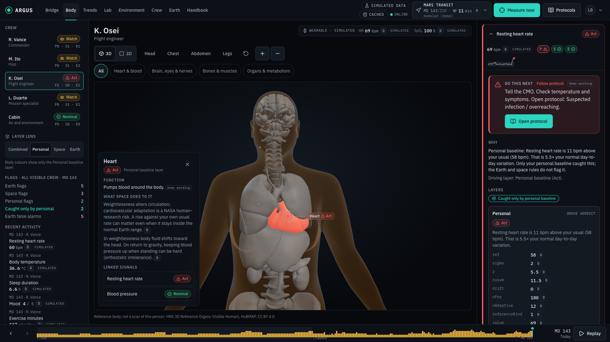
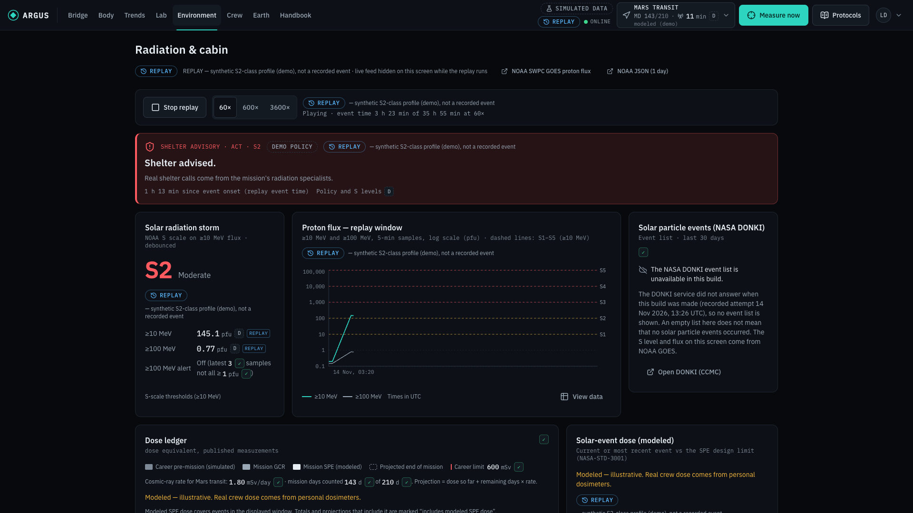
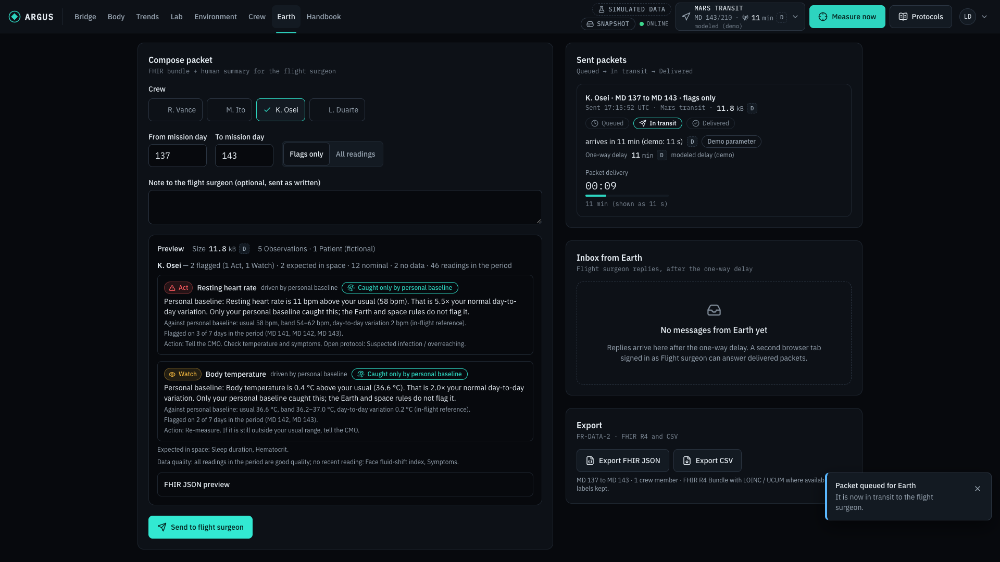
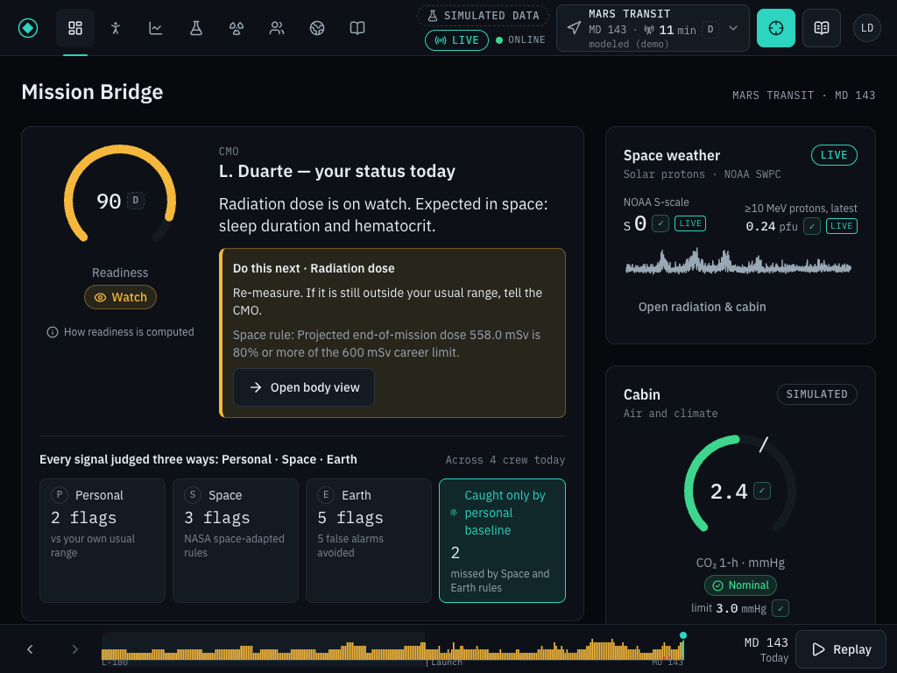

# ARGUS — Crew Health Autonomy

**NASA Space Apps Challenge 2026 · Challenge:** *Create Health Monitoring Software for Astronauts on Space Missions*

**Team:** Dark Star · İsmail Cem Şahin, Feyruz Sultanli, Fikret Mammadov, Rahil Bagirov
**Live demo:** https://feyruzsultanli.github.io/argus-crew-health/ (demo PIN **2026**) ·
**Slides (7):** [ARGUS-slides.pdf](docs/submission/slides/ARGUS-slides.pdf)

> **Read this first.** ARGUS is a hackathon prototype, not a medical device: it never diagnoses or gives drug doses.
> The four crew members and their day-by-day readings are simulated. The NOAA space-weather data and your own camera,
> reaction-test and manual measurements are real. Every number on screen links to its source and is labeled
> verified, partial or demo parameter.

## The problem

On a Mars mission a message to the flight surgeon takes many minutes each way; Earth reference ranges do not fit a
body adapting to spaceflight; and astronauts are measured only periodically, with separate devices. The crew has to
decide on board.

## What ARGUS does

- **Personal · Space · Earth verdicts.** Every health signal is judged against the astronaut's own baseline, against
  space-adapted rules from NASA standards and evidence, and against Earth reference ranges, plus a data-quality check.
  ARGUS shows which layer raised the flag and counts the concerns **caught only by the personal baseline**.
- **Measure with what's on board.** Webcam pulse (POS method, on-device face tracking, quality score), a 3-minute
  Reaction Self-Test modeled on NASA's PVT-B, an on-screen vision check (Amsler grid and near acuity; screening
  only), guided vital-sign entry, a quick check-in, and an experimental face fluid-shift scan (not validated, trend
  only).
- **Radiation and cabin awareness.** NOAA GOES proton flux (live, cached or bundled snapshot) → NOAA S-scale → crew
  dose ledger against NASA-STD-3001 limits (600 mSv career; 250 mSv solar-event design limit), shelter advisory (demo
  policy), cabin CO₂ against the 3 mmHg 1-hour limit.
- **Ready to plug into NASA.** Rules traced to NASA-STD-3001 items; FHIR-style export with LOINC/UCUM codes; a
  delay-aware Earth link with a separate flight-surgeon view; offline-first PWA.
- **Also:** clickable 3D body (HRA reference anatomy), mission-day time travel, trends with personal bands, crew
  overview for the Crew Medical Officer, today's plan with streaks and badges, five protocols, an offline handbook.

## Try the demo in 2 minutes

1. Open the live demo → role **CMO** → PIN **2026** → **Sign in as CMO**. You are on the Mission Bridge: Mars transit,
   day 143, Earth 11 minutes away (modeled delay).
2. **Crew at a glance** → click **K. Osei** (Act, "Caught only by personal baseline").
3. On her **Body** view, switch **Layer lens** Earth → Space → Personal: the heart lights up only on Personal. Open the
   Resting heart rate card: action first, then why, the three layers, her band and the sources.
4. **Lab** → Camera pulse (your own pulse, 30 s, with a quality score) or Reaction Self-Test.
5. **Environment** → **Replay SPE** (a synthetic storm replay) → then **Earth** → **Send to flight surgeon** and watch
   "arrives in 11 min (demo: 11 s)".

To start over: user menu → Settings → **Reset demo**. Demo controls (scenario jumps, profiles): `/settings?demo=1`.

## Screens

Real captures of the running app (crew data simulated, see the SIMULATED DATA badge); all 41 in
[`docs/submission/screenshots/`](docs/submission/screenshots/README.md).

| | |
|---|---|
|  |  |
| Body, lens Personal: the heart is Act only against her own baseline | Synthetic storm replay (REPLAY): S2, shelter advisory, modeled dose |
|  |  |
| Earth link: packet in transit over the modeled delay | Mission Bridge at tablet size (1024×768) |

## What is real and what is simulated

| Real or measured | Simulated, modeled or demo |
|------------------|----------------------------|
| NOAA GOES proton flux (live, else cached, else the bundled snapshot of 14 Nov 2026, with its age) | The four crew members and their daily readings; cabin CO₂, temperature and humidity |
| Pre-flight blood values from NASA OSDR OSD-569 / OSD-575 (anonymised Inspiration4 crew), used as anchors | The solar-storm replay: a **synthetic** S2-class profile, not a recorded event |
| Your camera pulse, reaction test and manual entries (labeled MEASURED) | Solar-event dose (modeled, illustrative) and pre-mission career doses (simulated) |
| Published limits and evidence (sources registry, `seed/sources.json`) | Mars-transit comms delay: a **modeled delay (demo)**, not derived from a trajectory; Earth-link delivery time-compressed (60×) |
| | Readiness index, points, streaks, demo band edges, baseline tuning constants (demo parameters) |

## What works today

- Three-layer verdict for 21 signals, with the driving layer named and every threshold sourced.
- Personal baseline engine (median/MAD, adaptive in-flight reference, z-score, CuSum, state machine), checked against
  ten specification test vectors and an independent reference implementation.
- Simulated Mars-transit crew with four scenarios on one timeline (silent infection, CO₂ pocket, sleep debt, vision
  change), plus five other mission profiles (ISS, lunar transit, lunar base, pressurized rover, Mars base).
- Camera pulse, Reaction Self-Test, vision check (screen calibration with a bank card, Amsler grid per eye compared
  with the previous test, near acuity at 60 cm; screening only), manual vitals, quick check-in.
- Face fluid-shift scan, experimental: a 3-second scan of face geometry against the first scan on the device; trend
  only, no image saved.
- Mission Bridge, 3D/2D body, trends, crew overview, Environment, Earth link with FHIR-style and CSV export, handbook
  with protocols and a rule-based Ask box, Settings, demo controls, Limits page.
- Offline-first: after the first visit the service worker has the app, the camera pulse model, the 3D bodies and the
  handbook cached (a full offline run on the deployed site is still on our manual check list).

## Known limits

- Not a medical device; no diagnosis, no drug doses. Demo thresholds have not been reviewed by clinicians.
- The camera pulse has **not** been compared with a reference device yet; it is a screening and trend value.
- The NASA DONKI solar-event list is **not connected** (the service did not answer on build day).
- The vision check is screening only, not a diagnosis. Its screen calibration is set by the user with a bank card and
  has not yet been checked independently with a ruler.
- The face fluid-shift scan is experimental and not validated: it has not been tried on a real face yet, the first scan
  on a device is the reference, and it never raises Watch or Act on its own.
- Not built yet: device import, respiration rate, encryption at rest, real identity (the PIN is a demo PIN).
- Radiation dose inside a vehicle is not computed with transport codes; real crew dose comes from dosimeters.

## Run it locally

```bash
npm install
npm run dev          # http://localhost:5173  (demo PIN 2026)
npm run build && npm run preview
npm test             # unit tests (Vitest)
npm run test:e2e     # Playwright smoke tests
```

**GitHub Pages build:** `.github/workflows/pages.yml` runs `npm run check`, then
`ARGUS_BASE=/argus-crew-health/ npm run build`, then copies `dist/index.html` to `dist/404.html` for deep links, and
deploys `dist/` to https://feyruzsultanli.github.io/argus-crew-health/.

## Data, sources and credits

- NASA and partner data used, and how: `docs/12_DATASETS_AND_SOURCES.md` and `docs/submission/PROJECT_PAGE.md`.
- Every cited fact with its status: `seed/sources.json`.
- Third-party assets and licenses: `CREDITS.md` (HRA 3D Reference Organs — HuBMAP/NIH, CC BY 4.0; MediaPipe —
  Apache-2.0; IBM Plex — OFL; Lucide — ISC; NASA OSDR and NOAA SWPC public data).
- No NASA logos, flags or insignia are used; the ARGUS mark is our own.
