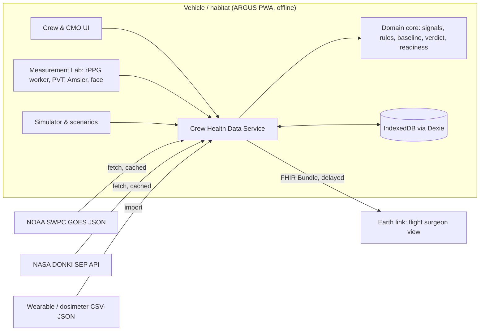

# 05 — Architecture

## 1. Principles

1. **Local-first, offline-first.** The browser *is* the vehicle computer. Everything runs client-side; the
   network is an optional source (space weather) and an optional sink (Earth link).
2. **Pure domain core.** All medical/statistical logic is framework-free TypeScript in `src/domain`, fully
   unit-tested, deterministic, and reusable on a server or vehicle computer later.
3. **Adapters at the edges (CHP-IDSP style).** Data enters through *source adapters* and leaves through
   *sink adapters*. The UI talks to a single **Crew Health Data Service** facade, never to Dexie directly.
4. **Provenance everywhere.** Each observation carries source, method, quality and time; each verdict carries
   the rule/baseline and source IDs used.
5. **Deterministic simulation.** Simulated crew data is generated from a seed so the demo is reproducible.

## 2. System context



## 3. Repository layout

```
argus/
├─ README.md                      # judge-facing overview
├─ CREDITS.md                     # third-party assets and licenses
├─ docs/                          # this documentation set (+ DECISIONS.md)
├─ seed/                          # versioned data the app ships with
│  ├─ sources.json                # every cited fact (single source registry)
│  ├─ signals.json                # optional data-driven parts of the catalog (labels, cadence)
│  ├─ missions.json               # mission profiles
│  ├─ crew.json                   # 4 fictional crew + pre-flight anchors
│  ├─ osdr/                       # downloaded OSDR CSVs (OSD-569 CBC, OSD-575 CMP)
│  ├─ radiation/                  # NOAA snapshot + SPE replay series
│  └─ handbook/                   # markdown entries for the offline handbook
├─ scripts/
│  ├─ fetch-data.ts               # downloads OSDR + NOAA + DONKI snapshots into seed/
│  ├─ build-anatomy.ts            # converts/compresses body GLBs into public/anatomy/
│  └─ check-sources.ts            # verifies every sourceId used in code exists in seed/sources.json
├─ public/
│  ├─ anatomy/                    # body.glb (+ organ GLBs), compressed
│  ├─ mediapipe/                  # tasks-vision wasm files + face_landmarker.task
│  └─ icons/, manifest assets
└─ src/
   ├─ main.tsx, App.tsx, routes.tsx
   ├─ config/                     # brand.ts, featureFlags.ts, constants.ts
   ├─ domain/                     # PURE TS — no React/DOM/Dexie
   │  ├─ types.ts                 # shared domain types (doc 06)
   │  ├─ units.ts                 # conversions + formatting helpers (pure)
   │  ├─ signals/                 # one file per signal + index.ts registry
   │  ├─ rules/                   # earth.ts, space.ts, quality.ts
   │  ├─ baseline/                # robust.ts, adaptive.ts, cusum.ts, stateMachine.ts
   │  ├─ verdict/                 # combine.ts, explain.ts
   │  ├─ readiness/               # readiness.ts, streaks.ts
   │  ├─ radiation/               # sscale.ts, doseLedger.ts, shelter.ts
   │  ├─ environment/             # co2.ts, cabin.ts
   │  ├─ plan/                    # todayPlan.ts (tasks from cadence/staleness)
   │  └─ fhir/                    # toFhir.ts (Bundle builder), loinc.ts
   ├─ services/
   │  ├─ healthService.ts         # facade: query/observe/add observations, assessments, tasks
   │  ├─ db.ts                    # Dexie schema + migrations
   │  ├─ adapters/
   │  │  ├─ manualSource.ts, cameraSource.ts, importSource.ts
   │  │  ├─ noaaSource.ts, donkiSource.ts      # fetch + cache + snapshot fallback
   │  │  └─ earthLinkSink.ts                   # delayed delivery, BroadcastChannel
   │  └─ sim/
   │     ├─ rng.ts                # seeded PRNG (mulberry32)
   │     ├─ generator.ts          # daily observations from baselines + shifts + noise
   │     └─ scenarios.ts          # infection onset, CO₂ spike, SPE, sleep debt, SANS drift
   ├─ measurement/
   │  ├─ rppg/                    # capture.ts, roi.ts, pos.ts, spectrum.ts, quality.ts, rppg.worker.ts
   │  ├─ face/                    # landmarker.ts (MediaPipe loader), fluidShiftIndex.ts
   │  ├─ vision/                  # calibration.ts, amsler.ts, acuity.ts
   │  └─ pvt/                     # pvtEngine.ts, pvtScoring.ts
   ├─ three/                      # BodyScene.tsx, Organ.tsx, Hotspot.tsx, cameraRig.ts, anatomyMap.ts
   ├─ ui/                         # design system: tokens.css, Button, Card, Badge, StatusPill, Value, Sheet, Tabs, Gauge, Sparkline, EmptyState, SourceDrawer…
   ├─ features/
   │  ├─ bridge/                  # Today / Mission Bridge
   │  ├─ body/                    # 3D crew health
   │  ├─ trends/
   │  ├─ lab/                     # Measurement Lab hub + flows
   │  ├─ environment/             # radiation + cabin
   │  ├─ crew/                    # CMO overview
   │  ├─ earthlink/
   │  ├─ handbook/                # handbook + protocols + Q&A
   │  ├─ settings/                # settings, demo controls, limits page
   │  └─ auth/                    # role picker
   ├─ state/                      # zustand stores: session.ts, mission.ts, ui.ts
   └─ test/                       # test utils, fixtures
```

## 4. Key modules and contracts

### 4.1 Crew Health Data Service (`services/healthService.ts`)
```ts
export interface HealthService {
  // observations
  addObservation(o: NewObservation): Promise<Observation>;            // validates, assigns id, persists, triggers re-assessment
  observations(q: ObsQuery): Promise<Observation[]>;
  // assessments (derived, cached per crew/signal/missionDay)
  assess(crewId: string, missionDay: number): Promise<Assessment[]>;  // runs domain.verdict for every signal
  // plan
  todayPlan(crewId: string, missionDay: number): Promise<Task[]>;
  // environment
  environment(missionDay: number): Promise<EnvironmentSnapshot>;
  spaceWeather(): Promise<SpaceWeatherState>;                          // live → cache → snapshot
  // earth link
  sendPacket(p: PacketRequest): Promise<Packet>;
}
```
React components use hooks in `features/*/hooks.ts` wrapping `useLiveQuery` so the UI updates on writes.

### 4.2 Domain pipeline (pure)
```
Observation[] (one signal, one crew) ─┬─► baseline.compute()  ─► PersonalResult
                                       ├─► rules.space.evaluate() ─► LayerResult
                                       ├─► rules.earth.evaluate() ─► LayerResult
                                       └─► rules.quality.evaluate() ─► QualityResult
                                                    │
                                                    ▼
                                      verdict.combine() ─► Assessment (verdict, drivers, explanation, sourceIds)
```
Combination rules are in doc 07 §3.

### 4.3 rPPG worker
Main thread: camera + MediaPipe Face Landmarker (VIDEO mode, ~30 fps) → per-frame ROI mean RGB +
timestamp → `postMessage` to `rppg.worker.ts` → worker runs resampling, POS, band-pass, Welch PSD, quality →
returns `{bpm, snrDb, quality, spectrum, waveform}` every 1 s for the live UI and once at the end.

### 4.4 Space weather adapters
`noaaSource.fetchProtons()` → normalises to `ProtonSample[]` → stores in `spaceWeather` table with
`fetchedAt`; on failure returns cached; if none, loads `seed/radiation/goes-snapshot.json`. Same for DONKI.
Optional: Vercel serverless proxies `api/proxy-swpc.ts` and `api/proxy-donki.ts` (same names as doc 10 §1) only
if CORS blocks the browser (check first; document).

## 5. State management

| State | Where | Why |
|-------|-------|-----|
| Session (role, signed-in crew) | Zustand `session` + localStorage | small, synchronous |
| Mission (profile id, mission day, time compression, demo flags) | Zustand `mission` persisted | global, drives everything |
| UI (selected crew, selected signal, layer toggle, body system filter, theme) | Zustand `ui` | transient |
| Observations, assessments cache, tasks, messages, space weather, streaks | Dexie | persistent, queryable, live |

## 6. Dexie schema (v1)

```ts
db.version(1).stores({
  crew:          'id',
  observations:  'id, [crewId+signalId+missionDay], [crewId+missionDay], signalId, source.kind',
  assessments:   '[crewId+signalId+missionDay], crewId, verdict',
  tasks:         'id, [crewId+missionDay], status',
  messages:      'id, direction, status, sentAt',
  packets:       'id, status, createdAt',
  spaceWeather:  'id, kind, timeTag',
  settings:      'key',
  streaks:       '[crewId+kind]',
  visionMaps:    'id, [crewId+eye+missionDay]',
});
```
Seeding: on first load (or "Reset demo"), `sim.generator` writes pre-flight + in-flight observations for
mission days −180…N (N = profile's demo day, default 143 for Mars transit). There is no mission day 0 (−1 is
followed by launch day 1). Nothing is generated after N and the scrubber stops at N. Switching the mission profile
re-seeds the same crew timeline truncated at that profile's `demoMissionDay`; scenarios whose days fall outside
that range simply do not occur (say so in the profile picker).

## 7. Routing

| Path | Screen | Roles |
|------|--------|-------|
| `/` | Mission Bridge (Today) | all |
| `/body/:crewId?` | 3D crew health | crew (self), CMO |
| `/trends/:crewId?` | Trends | crew (self), CMO, surgeon (received only) |
| `/lab` and `/lab/:flow` | Measurement Lab (camera, pvt, vision, manual, import) | crew, CMO |
| `/environment` | Radiation & cabin | all |
| `/crew` | Crew overview | CMO, surgeon |
| `/earth` | Earth link | all (different views) |
| `/handbook` and `/handbook/:entry` | Handbook, protocols, Q&A | all |
| `/settings`, `/limits` | Settings, demo controls, honesty page | all |

## 8. PWA / offline

- `vite-plugin-pwa` with `registerType: 'autoUpdate'`, precache app shell, `public/seed/**`, `public/anatomy/**`,
  `public/mediapipe/**` (≈ 10–25 MB total; acceptable — show "Downloading offline package" progress once).
- Workbox defaults would silently skip most of that: by default only `**/*.{js,css,html}` is precached and any file
  over 2 MiB is left out. Set `workbox.globPatterns` to include `json, md, csv, wasm, task, glb, woff2, svg, png,
  ico` and raise `workbox.maximumFileSizeToCacheInBytes` (30 MB), then check the generated precache manifest.
- Seed data at run time: `seed/sources.json`, `crew.json`, `missions.json`, `scenarios.json` and `protocols.json`
  are imported statically. Files that are fetched (`seed/radiation/**`, `seed/handbook/**`,
  `seed/import-samples/**`) are copied to `public/seed/` by `npm run sync:seed` (run by `predev` and `prebuild`)
  and fetched from `/seed/...`.
- Runtime caching: NOAA/DONKI requests `NetworkFirst` with 3-s timeout.
- Offline indicator in header; space-weather panel shows "cached · 2 h old".

## 9. Security & privacy notes (for the "real deployment" section)

- Demo uses role picker + shared PIN — flight version would use the agency identity system.
- At-rest encryption (WebCrypto AES-GCM over IndexedDB records) is a P2 item; document as future work.
- No third-party analytics, fonts or CDNs at runtime (MediaPipe self-hosted).

## 10. Performance budget

| Asset | Budget |
|-------|--------|
| Initial JS (gzip) | ≤ 300 KB (code-split three.js, MediaPipe, Recharts by route) |
| Body GLB (male + female, compressed) | ≤ 8 MB total, lazy |
| MediaPipe wasm + model | ≈ 8–10 MB, lazy on first Lab use, precached |
| Re-assessment of one crew-day | ≤ 20 ms |
